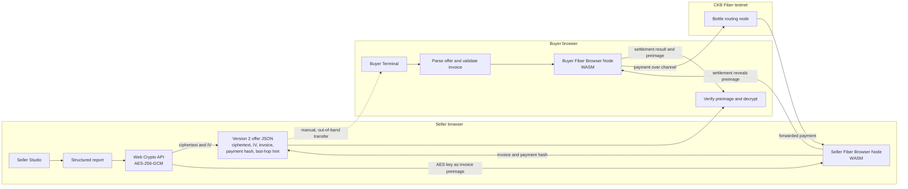

# FiberVault


**Encrypted digital delivery where successful payment reveals the decryption key.**

FiberVault is a browser-based demonstration of pay-to-unlock content using CKB Fiber Network payment channels. Sellers encrypt a report locally and create a 1 CKB Fiber invoice whose payment preimage is the content key. After the invoice settles, the buyer receives the preimage and decrypts the report in the browser.

| Resource | Link |
| --- | --- |
| Live application | [ckbbbb.vercel.app](https://ckbbbb.vercel.app) |
| Source repository | [daodudestiny56-netizen/ckbbbb](https://github.com/daodudestiny56-netizen/ckbbbb) |
| CKB testnet faucet | [faucet.nervos.org](https://faucet.nervos.org) |

> FiberVault is a testnet demonstration, not a production marketplace or custody service. Read [Security model and limitations](#security-model-and-limitations) before using it.

## At a glance

- **Client-side encryption:** Web Crypto API AES-256-GCM encrypts the report in the seller's browser.
- **Payment-bound key release:** The AES key is the invoice preimage; its SHA-256 digest is the invoice payment hash.
- **Fiber routing:** The buyer pays across the testnet channel route `Buyer -> Bottle -> Seller`.
- **Offer validation:** Versioned offer parsing checks the encrypted payload structure and Bottle last-hop hint. The buyer node also checks invoice currency, amount, and payment hash.
- **Two operating modes:** Live Fiber testnet nodes and a clearly labeled offline simulator. The simulator makes no blockchain transactions.
- **Cryptographic receipt:** The interface verifies the revealed preimage against the payment hash and can export a receipt.

## System architecture

The Next.js application is the browser interface; encryption, decryption, and Fiber WASM node sessions run client-side. The offer is transferred from seller to buyer outside the payment route, for example by copying its JSON.



### Main components

| Component | Responsibility |
| --- | --- |
| `app/page.tsx` | Seller Studio, Buyer Terminal, channel setup, payment steps, and status reporting |
| `app/globals.css` and `app/layout.tsx` | Responsive white-and-orange neo-brutalist UI and Bricolage Grotesque typography |
| `lib/crypto.ts` | AES-GCM encryption/decryption, preimage verification, and report serialization |
| `lib/offer.ts` | Version 2 encrypted offer creation, parsing, and structural validation |
| `lib/fiber.ts` | Testnet browser-node setup, Bottle peer connection, and channel operations |
| `lib/payment.ts` and `lib/payment-submission.ts` | Invoice validation, expiration checks, safe submission, and payment-result recovery |
| `lib/node-session.ts` | Exclusive browser-tab ownership for saved Fiber node profiles |
| `lib/simulator.ts` | Offline mock nodes, channels, offers, and payments for UI walkthroughs |
| `lib/progress.ts` | Validation and persistence helpers for non-secret lesson progress |

## Payment and unlock lifecycle

1. **Prepare content.** The seller selects a sample report or authors custom content.
2. **Encrypt locally.** The browser generates a random 32-byte AES key and 12-byte IV, then encrypts the report with AES-256-GCM.
3. **Create the invoice.** The seller's Fiber node creates a 1 CKB invoice using the AES key as its payment preimage and SHA-256 as the hash algorithm.
4. **Share the offer.** The seller sends the offer JSON to the buyer out-of-band. It contains ciphertext, IV, invoice, payment hash, and a last-hop hint; it does not contain the plaintext report.
5. **Validate and challenge.** The buyer checks the offer and invoice, then can try decrypting with a random key to confirm AES-GCM rejects it.
6. **Pay over Fiber.** The buyer submits the invoice through the `Buyer -> Bottle -> Seller` route.
7. **Verify and unlock.** After settlement, the buyer receives the preimage, verifies that its SHA-256 matches the invoice payment hash, and decrypts the report.
8. **Export.** The buyer can download the unlocked Markdown report and a JSON payment receipt.

The key relationship is:

```text
payment_hash = SHA-256(AES_key)
```

The application checks the invoice amount and currency against the expected 1 CKB testnet invoice. Payment submission is guarded against expired invoices, mismatched hashes, and accidental resubmission of pending attempts.

## Run locally

### Requirements

- Node.js 22.18 or later
- npm 10 or later
- A modern browser with WebAssembly, Web Crypto, and Web Locks support

### Install and start

```bash
git clone https://github.com/daodudestiny56-netizen/ckbbbb.git
cd ckbbbb
npm ci
npm run dev
```

Open [http://localhost:3001](http://localhost:3001).

### Validate the project

```bash
npm test
npm run typecheck
npm run build
```

`npm start` serves the production build on Next.js's default port. The development server uses port `3001`.

### WebAssembly isolation headers

The Fiber browser runtime requires cross-origin isolation. `next.config.mjs` configures:

- `Cross-Origin-Opener-Policy: same-origin`
- `Cross-Origin-Embedder-Policy: require-corp`

These headers are required for browser capabilities such as `SharedArrayBuffer`. Keep them enabled when changing the hosting configuration.

## Live CKB testnet walkthrough

The application starts in **Live WASM** mode. Testnet nodes and channel operations use real CKB testnet resources.

1. Start **Buyer A** and **Seller C** from the Network Topology section.
2. Request testnet CKB for each node using its displayed address and the [CKB testnet faucet](https://faucet.nervos.org).
3. Open a 500 CKB channel from each node to Bottle and wait for both channels to reach `CHANNEL_READY`.
4. On the seller channel, use **Send 5 CKB keysend** to give Bottle inbound liquidity toward the seller.
5. In Seller Studio, select a preset or enter custom content, then create the encrypted offer and 1 CKB invoice.
6. Use **Bridge to Buyer Terminal** for the in-page walkthrough, or copy the offer JSON to transfer it to a separate buyer.
7. In Buyer Terminal, validate the offer, run the unauthorized-decryption challenge, and pay the invoice.
8. After successful settlement, decrypt the report and export the report or receipt.

Channel funding is real testnet CKB. Wait for on-chain confirmations; the interface reports channel state and provides status refresh controls. Do not use valuable funds.

## Offline simulator

Select **Offline Simulator** to explore the interface without starting Fiber WASM nodes or funding channels. The simulator uses synthetic balances, invoices, routing, and payment results. It does not submit transactions and must not be used as evidence of a real on-chain settlement.

## Security model and limitations

FiberVault demonstrates how a payment preimage can also serve as an encryption key. It does not make the seller, buyer, or browser a trusted custodian.

- **Offer and key must both remain private to prevent access.** Anyone with both the ciphertext offer and the settled preimage can decrypt the content.
- **The routing node learns the preimage.** Bottle participates in the Fiber route and can learn the preimage at settlement. It does not receive the offer through the app, but an intermediary that obtains both the offer and preimage can decrypt it.
- **The seller retains control of the original.** Encryption and invoice creation happen in the seller's browser. The protocol cannot prevent a seller from keeping or separately sharing the plaintext or key.
- **Browser node credentials are local.** The current implementation stores Fiber and CKB node key material in the browser's `localStorage`. Use a dedicated testnet browser profile and do not reuse valuable or production keys.
- **Use one active tab per saved node profile.** Web Locks prevent two tabs from controlling the same saved profile at once. Close other FiberVault tabs before restarting that node.
- **Recipient key wrapping is experimental.** Helper functions exist, but the optional UI flow is not implemented end-to-end for live offers. Do not rely on it as an intermediary-privacy control.
- **Testnet only.** This project is not audited, does not support mainnet, and is not a production payment or content-hosting service.

## Tests

The current test suite contains 18 Node.js tests across `payment.test.mjs` and `vault.test.mjs`. It covers payment submission guards and recovery, AES-GCM encryption and tamper rejection, preimage/hash checks, offer serialization, key-wrapping helpers, replay rejection, and the offline simulator.

Run the suite with:

```bash
npm test
```

## Repository map

```text
app/
  globals.css                  Global design system and responsive styles
  layout.tsx                   App metadata and Bricolage Grotesque font
  page.tsx                     Seller and buyer application workflow
lib/
  channel-funding.ts            Testnet channel funding checks
  crypto.ts                     Encryption, decryption, and proof helpers
  fiber-testnet-runtime.ts      Fiber WASM testnet factory
  fiber.ts                      Browser nodes, Bottle peer, and channels
  node-session.ts               Browser-tab node session lock
  offer.ts                      Encrypted offer schema and validation
  payment-submission.ts         Submission and recovery safeguards
  payment.ts                    Invoice validation and payment orchestration
  progress.ts                   Browser progress and payment-state helpers
  simulator.ts                  Offline mock Fiber flow
  vault-presets.ts              Sample encrypted reports
  vault-types.ts                Report and verification types
payment.test.mjs                Payment flow tests
vault.test.mjs                  Encryption, offer, and simulator tests
next.config.mjs                 Next.js settings and isolation headers
```
